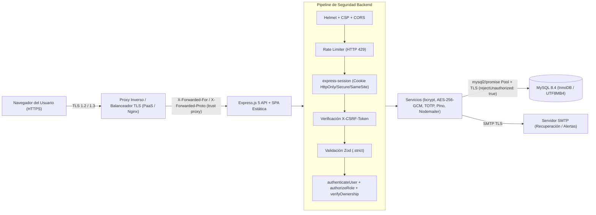
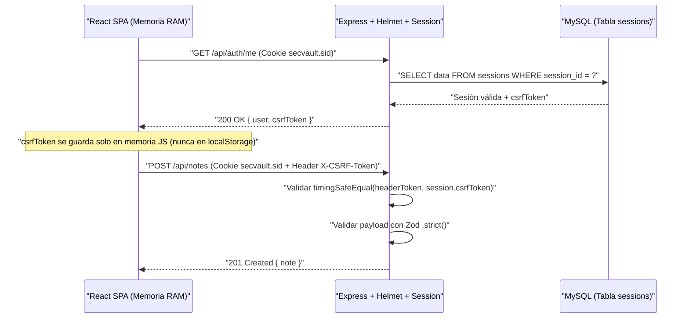
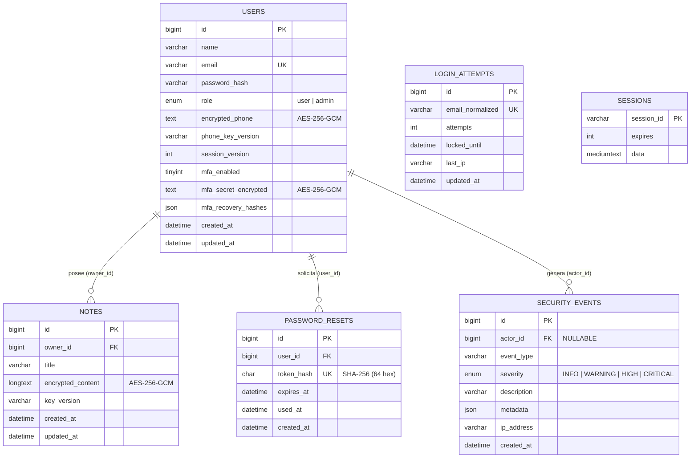
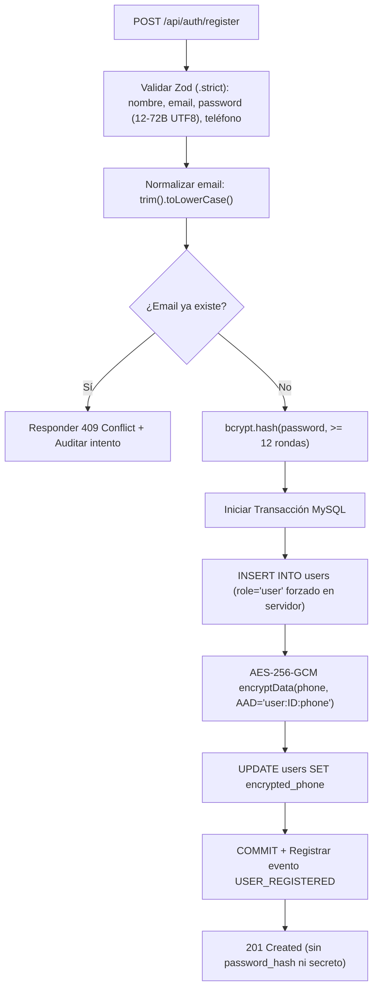
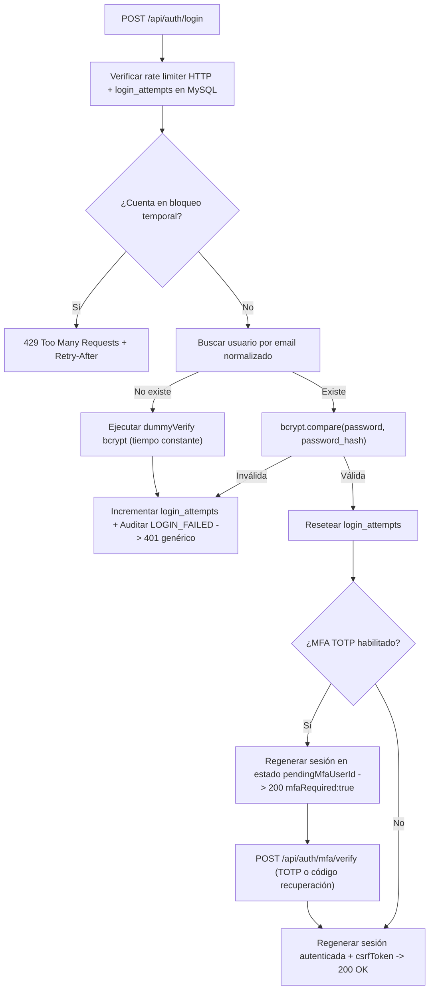
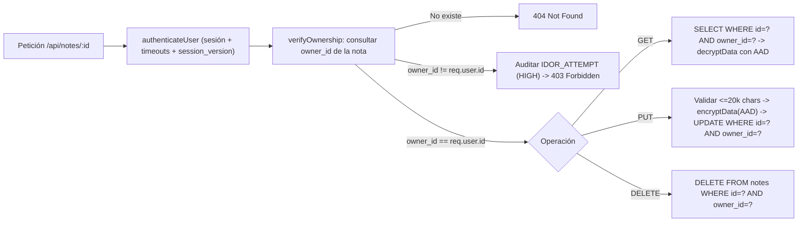
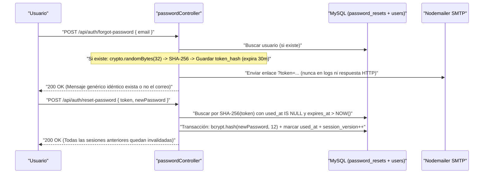
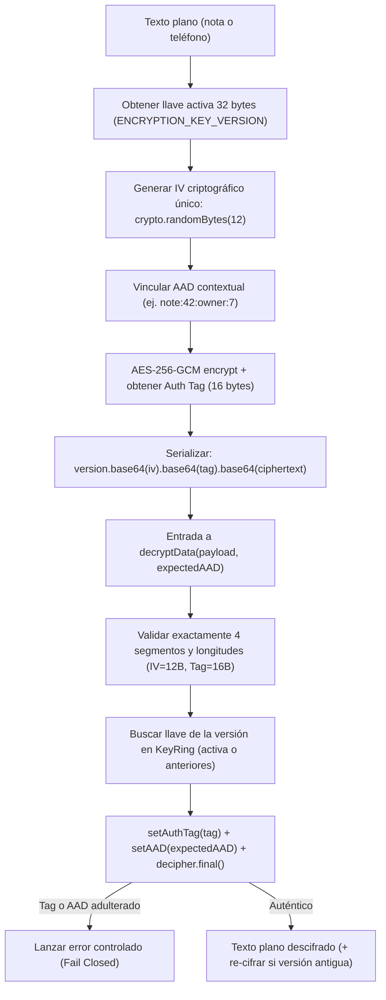

# Arquitectura del Sistema — SecureVault

**Autor:** Josué (Proyecto Individual)  
**Última actualización:** 2026-11-25  

---

## 1. Visión General de la Arquitectura

SecureVault implementa una arquitectura Full Stack de tres capas orientada a defensa en profundidad:

1. **Capa de Presentación (Frontend SPA):** React 18+ y Vite compilados a artefactos estáticos servidos desde el mismo origen (`same-origin`) en producción o mediante proxy seguro en desarrollo. No almacena secretos ni tokens en `localStorage` ni `sessionStorage`.
2. **Capa de Aplicación y Seguridad (Backend API):** Node.js v22 LTS + Express.js con arquitectura modular estricta (`config` -> `middlewares` -> `routes` -> `controllers` -> `services` -> `repositories` -> `validators`). Aplica Helmet (CSP estricta, HSTS, `X-Frame-Options: DENY`), CORS restringido, limitación de tasa (`express-rate-limit`), protección CSRF por sesión, validación Zod `.strict()`, hash `bcrypt` (>= 12 rondas) y cifrado autenticado `AES-256-GCM` con AAD.
3. **Capa de Persistencia (Base de Datos MySQL 8.0+/8.4):** Motor InnoDB con conjunto de caracteres `utf8mb4`, integridad referencial por llaves foráneas, transacciones ACID, consultas 100% parametrizadas con `mysql2/promise` y almacenamiento persistente de sesiones HTTP mediante `express-mysql-session`.

### Diagrama 1: Arquitectura General del Sistema

---

## 2. Comunicación Frontend / Backend

En producción, Express sirve los archivos compilados de `frontend/dist` bajo el mismo dominio (`APP_URL`), eliminando problemas de cookies de terceros (`third-party cookies`). Todas las peticiones autenticadas viajan con `credentials: 'include'`:

- Las operaciones de lectura (`GET`) validan la cookie de sesión `secvault.sid` (`HttpOnly`, `Secure` en producción, `SameSite=Lax` o `Strict`).
- Las operaciones de escritura (`POST`, `PUT`, `PATCH`, `DELETE`) exigen adicionalmente la cabecera `X-CSRF-Token`, generada aleatoriamente por el servidor al iniciar/regenerar la sesión y verificada con `crypto.timingSafeEqual`.

### Diagrama 2: Comunicación Frontend / Backend y Protección de Sesión/CSRF

---

## 3. Modelo de Datos MySQL (Diagrama Entidad-Relación)

Todas las tablas utilizan `ENGINE=InnoDB` y `DEFAULT CHARSET=utf8mb4 COLLATE=utf8mb4_unicode_ci` para soportar texto internacional seguro y garantizar transacciones ACID.

### Diagrama 3: Entidad-Relación (ERD)

### Justificación Técnica de la Elección de MySQL
Aunque el documento guía del laboratorio sugiere PostgreSQL o MongoDB, este proyecto adopta **MySQL 8.0+/8.4** por decisión técnica del estudiante debido a:
- **Integridad relacional estricta (ACID + InnoDB):** Garantiza consistencia transaccional en el registro de usuarios (creación + cifrado del teléfono vinculado al `id`), creación/rotación de notas y restablecimiento de contraseñas.
- **Almacenamiento maduro de sesiones:** `express-mysql-session` mantiene las sesiones directamente en MySQL sobre `mysql2/promise`, permitiendo invalidación inmediata y auditoría centralizada sin desplegar un segundo motor como Redis.
- **Portabilidad y desempeño:** `mysql2` soporta sentencias preparadas (`pool.execute`) nativas con placeholders `?` para erradicar inyección SQL y soporte TLS estricto en producción (`rejectUnauthorized: true`).

---

## 4. Flujos Críticos de Seguridad

### Diagrama 4: Flujo de Registro (RF-01)

### Diagrama 5: Flujo de Inicio de Sesión, Bloqueo Progresivo y MFA TOTP

### Diagrama 6: Flujo CRUD de Notas Privadas (RF-04 + Anti-IDOR)

### Diagrama 7: Flujo de Recuperación de Contraseña (RF-06)

### Diagrama 8: Flujo de Cifrado, Descifrado AES-256-GCM y Rotación de Llaves

---

## 5. Gestión de Sesiones, Llaves y Rotación

### Gestión de Sesiones (`express-session` + `express-mysql-session`)
- Al autenticarse o verificar MFA, se invoca `req.session.regenerate()` para prevenir fijación de sesión (*Session Fixation*).
- Se aplican dos ventanas de expiración validadas en cada solicitud por `authenticateUser`:
  - **Inactividad:** `SESSION_IDLE_TIMEOUT_MS` (30 minutos por defecto).
  - **Duración absoluta:** `SESSION_ABSOLUTE_TIMEOUT_MS` (12 horas por defecto).
- Además se valida `user.session_version === req.session.sessionVersion`: cuando un usuario cambia su contraseña, restablece su contraseña o un administrador modifica su rol, `session_version` se incrementa atómicamente en MySQL, revocando de inmediato cualquier otra sesión activa.

### Gestión y Rotación de Llaves Criptográficas
- Las llaves nunca se codifican en código fuente ni en Git; se validan estrictamente en el arranque (`fail-closed`): 64 dígitos hexadecimales (256 bits).
- Cada registro cifrado guarda el prefijo de versión (`v1.`, `v2.`, etc.).
- Para rotar sin pérdida de datos:
  1. Se mueve la llave saliente a `DATA_ENCRYPTION_PREVIOUS_KEYS=v1:<hex_anterior>`.
  2. Se define la nueva llave en `DATA_ENCRYPTION_KEY=<hex_nuevo>` y `ENCRYPTION_KEY_VERSION=v2`.
  3. Las lecturas descifran con `v1` y re-cifran progresivamente a `v2`, o bien el administrador ejecuta `POST /api/admin/crypto/rotate` / `npm run crypto:rotate` para migrar todo el lote de forma controlada.
  4. **Advertencia crítica:** Perder la llave correspondiente a una versión sin respaldo provoca la **pérdida permanente e irrecuperable** de los datos cifrados bajo dicha versión.
